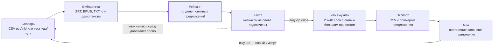
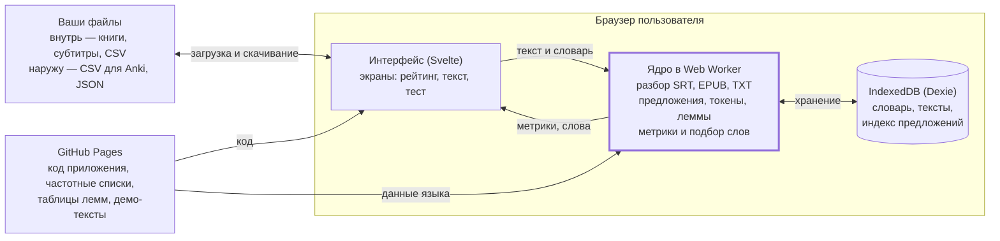

# Coverage Finder: проектный документ

19 ноября 2026

## Идея

Coverage Finder — веб-инструмент без сервера: по вашему словарю он показывает, какие книги и субтитры вы уже поймёте, и какие 20–40 слов выучить, чтобы понять следующий текст. Файлы пользователя не покидают его устройство.

- **Для кого:** для тех, кто самостоятельно учит английский на уровне B1–B2, учит слова в Anki и читает или смотрит сериалы в оригинале. Второй язык — испанский, после MVP.
- **Какую проблему решает:** контент выбирают наугад и бросают, если сложно. Для самостоятельного чтения нужно знать около 98% слов текста, но даже высокий процент знакомых слов не гарантирует, что реплики понятны целиком.
- **Что делает иначе:**
  1. Считает не только процент знакомых слов, но и долю предложений, которые понятны целиком, и предложений с ровно одним новым словом.
  2. Подбирает слова, которые сильнее всего поднимут понятность именно выбранного текста, а не просто самые частотные.
  3. Работает с любыми файлами пользователя — SRT, EPUB, TXT — и не загружает их на сервер.
  4. Открытый код и описанная методика: каждую цифру можно проверить.
- **Чем проект не является:** читалкой, системой интервальных повторений, словарём или переводчиком. Он отвечает на один вопрос: «что мне читать или смотреть сейчас и что выучить, чтобы перейти к следующему».
- **Название** рабочее; его стоит пересмотреть перед публичным запуском.

## Пользователь и сценарии

Основной пользователь уже учит слова каждый день и хочет перейти к настоящим книгам и сериалам, но не знает, с чего начать. Портрет ниже собирательный; его нужно сверить с реальными откликами в первую неделю. \[Гипотеза\]

- **Кто:** учит английский 2–3 года, уровень B1–B2, словарь — условно 3–6 тысяч слов; 15–20 минут в день в Anki.
- **Боль:** открывает сериал, понимает половину и бросает; учит частотные слова из общих колод, которые в его контенте почти не встречаются.
- **Что у него есть:** колода Anki, файлы субтитров и книг в EPUB, ноутбук и телефон.

### Задачи пользователя

1. «Покажи, что из моих файлов я уже могу читать или смотреть без словаря».
2. «Скажи, какие слова выучить, чтобы понять вот эту книгу или сезон».
3. «Покажи, что стало доступно за месяц».

### Первые 5 минут

1. Открывает сайт и видит демо-библиотеку и кнопку «Оценить свой словарь».
2. Проходит короткий тест (около трёх минут) или загружает список слов, выгруженный из Anki.
3. Видит рейтинг: у каждой книги три числа и метка «можно читать», «с усилием» или «рано».
4. Перетаскивает файл субтитров своего сериала — он встаёт в рейтинг.
5. Открывает его: незнакомые слова подсвечены, сбоку — «выучите эти 25 слов, и понятных предложений станет больше на X%».
6. Экспортирует эти слова в CSV для Anki.

### Регулярное использование

- Раз в неделю обновляет список известных слов из Anki, и рейтинг пересчитывается.
- Прямо в тексте отмечает кликом слова, которые уже знает.
- Перед выбором следующей серии или книги смотрит рейтинг и график «что стало доступно».

## Конкуренты и отличие

Идея «читать и отмечать знакомые слова» занята несколькими продуктами, но все они — читалки, в которые нужно импортировать тексты или которые нужно устанавливать. Свободное место — быстрая оценка понятности по предложениям и подбор слов под конкретный текст без установки.

| Продукт | Что это | Как оценивает сложность | Лицензия и установка | Чего не хватает для нашей задачи |
| --- | --- | --- | --- | --- |
| [LingQ](https://forum.lingq.com/t/reading-comprehension-strategies/834078) | платная платформа чтения со счётчиком известных слов | процент новых слов считается от уникальных слов, а не от общего числа | подписка, облако | нет метрики по предложениям; пользователи [просят другие метрики](https://lingq.canny.io/feature-requests/p/allow-to-sort-texts-by-known-not-just-by-unlinked) |
| [Lute v3](https://github.com/LuteOrg/lute-v3) | читалка со статусами слов | [оценка процента известных слов по книге](https://github.com/jzohrab/lute/wiki/Stats-calculation) | [MIT](https://www.linuxlinks.com/lute-learning-texts/), локальная установка на Python | нужно устанавливать и читать внутри Lute; подбора слов под текст нет |
| [Learning with Texts (форк HugoFara)](https://packagist.org/packages/hugofara/lwt) | self-hosted читалка | классы «легко / средне / сложно» и рекомендации текстов из открытых библиотек | [Unlicense](https://www.linuxlinks.com/learningwithtexts/), сервер или Docker | ближе всего к нашей идее; нужен сервер; методику оценки нужно изучить |
| [LinguaCafe](https://selfhostyourself.com/services/linguacafe) | self-hosted платформа чтения, импорт книг и субтитров | не проверял | GPL-3.0, Docker; новых коммитов нет с марта 2025 года | серверная установка, развитие замедлилось |
| [Jiten](https://jiten.moe) | каталог японских тайтлов с анализом словаря | личное покрытие для каждого тайтла, импорт из Anki | веб-сервис | только японский и только каталог сайта, а не ваши файлы |

### В чём наше отличие

- **Ничего не нужно устанавливать:** открыл сайт — работает, файлы не загружаются на сервер.
- **Метрика по предложениям**, а не по уникальным словам.
- **Подбор «разблокирующих» слов** для конкретного текста.
- **Дополняет Anki и любую читалку**, а не заменяет их: пользователю не нужно менять привычки.
- **Риск:** LWT уже рекомендует тексты по уровню. В первую неделю нужно изучить его методику, чтобы отличие было не только в «без установки».

## Методика

Инструмент считает три числа для каждого текста и подбирает слова жадным алгоритмом. Все формулы и пороги публикуются в README, а пороги калибруются по отзывам пользователей.

### Разбор текста

1. **Единицы текста.** Для SRT единица — реплика (один блок субтитров); для EPUB и TXT — предложение.
2. **Токенизация.** Числа, пунктуация и разметка субтитров отбрасываются.
3. **Лемматизация.** Каждая форма приводится к словарной (went → go, studies → study).
4. **Имена собственные.** Слово с заглавной буквы не в начале предложения и не из словаря считается именем и не делает предложение непонятным. Пользователь может исправить ошибку кликом.
5. **В первой версии не учитываются** фразовые глаголы и устойчивые выражения: give up считается знакомым, если знакомы give и up. Это завышает понятность, и ограничение нужно честно написать в интерфейсе.

### Три метрики

Пусть K — множество известных лемм, в тексте N токенов и n предложений, U(s) — множество незнакомых лемм предложения s.

1. **Покрытие слов** — доля знакомых слов среди всех словоупотреблений, а не среди уникальных слов, как в LingQ:

```math
C_{\text{tok}} = \frac{\left|\{\, t : \operatorname{lemma}(t) \in K \,\}\right|}{N}
```

2. **Доля понятных предложений** — главная метрика рейтинга:

```math
C_{\text{sent}} = \frac{\left|\{\, s : |U(s)| = 0 \,\}\right|}{n}
```

3. **Доля предложений «плюс одно слово»** — самый полезный материал для изучения нового слова в контексте:

```math
C_{i+1} = \frac{\left|\{\, s : |U(s)| = 1 \,\}\right|}{n}
```

**Метки в рейтинге.** «Можно читать» — покрытие слов не ниже 98%; «с усилием» — 95–98%; «рано» — ниже 95%. Ориентир 98% взят из [работы Nation](https://www.wgtn.ac.nz/__data/assets/pdf_file/0018/1626120/2006-How-large-a-vocab.pdf), но [позднее исследование нашло плавную зависимость без жёсткого порога](https://www.lextutor.ca/cover/papers/schmitt_etal_2011.pdf), поэтому метки — подсказка, а не приговор. Как метки сочетать с долей понятных предложений, покажет сравнение с самооценкой пользователей. \[Гипотеза\]

### Подбор слов для выучивания

Задача: выбрать k слов, после изучения которых станет понятным наибольшее число предложений. Это задача на максимальное покрытие, для неё стандартно используют жадный алгоритм.

1. Для каждой незнакомой леммы u считаем выигрыш — сколько предложений станет понятными, если выучить только её, плюс маленький бонус за частоту в тексте, чтобы алгоритм не застревал на сложных текстах, где почти нет предложений с одним новым словом.
2. Берём лемму с наибольшим выигрышем, добавляем её в K и пересчитываем только предложения, где она встречается.
3. Повторяем k раз; для каждого шага показываем накопленный прирост — пользователь видит, что даёт каждое следующее слово.

```math
\operatorname{gain}(u) = \left|\{\, s : U(s) = \{u\} \,\}\right| + \varepsilon \cdot \operatorname{freq}_T(u)
```

На одну книгу в 100 тысяч слов и k = 40 это несколько десятков миллисекунд с инвертированным индексом «лемма → предложения». \[Гипотеза: проверить замером\]

### Тест словаря для тех, у кого нет Anki

- **Формат «да/нет»:** 60 настоящих слов из разных частотных диапазонов (от первой до десятой тысячи) и 20 псевдослов. Слово отмечается, если пользователь знает его значение.
- **Зачем псевдослова:** \[Факт\] в таких тестах несуществующие слова используются, чтобы [ловить переоценку своих знаний](https://lognostics.co.uk/vlibrary/meara1991.doc), а доля ложных «да» идёт в поправку на угадывание.
- **Оценка словаря:** доля «да» в каждом диапазоне с поправкой умножается на размер диапазона; известными считаются самые частотные слова в этом объёме.

```math
h'_b = \frac{H_b - FA}{1 - FA}, \qquad \widehat{V} = \sum_b h'_b \cdot |b|
```

- **Ограничение:** такая оценка грубая, и [есть работы, где скорректированные баллы оказались ненадёжными](https://openaccess.library.uitm.edu.my/Record/ndltd-bl.uk-oai-ethos.bl.uk-594177/Description). Поэтому тест — только старт; дальше словарь уточняется кликами «знаю / не знаю» в тексте.
- **Псевдослова** генерируются из буквенных сочетаний настоящих слов и проверяются по словарю, чтобы не зависеть от чужих списков с неясной лицензией.

## Функции MVP

MVP — версия, которую можно показать за месяц: английский язык, книги и субтитры, словарь из CSV или теста. Всё остальное откладывается, пока не подтверждён спрос.

| Функция | Приоритет | Зачем | Срок |
| --- | --- | --- | --- |
| Импорт словаря из текстовой выгрузки Anki или CSV/TXT (одно слово в строке) | Обязательно | Главный вход для пользователей Anki | Неделя 1 |
| Тест словаря «да/нет» на 80 слов | Обязательно | Вход для тех, у кого нет списка слов | Неделя 2 |
| Загрузка SRT, TXT и EPUB, разбор в фоновом потоке | Обязательно | Ядро продукта | Неделя 1–2 |
| Три метрики и метка готовности для каждого текста | Обязательно | Ответ на вопрос «что читать» | Неделя 2 |
| Таблица-рейтинг библиотеки с сортировкой и фильтрами | Обязательно | Главный экран | Неделя 2 |
| Список «выучи эти 20–40 слов» с приростом понятности | Обязательно | Отличие от конкурентов | Неделя 3 |
| Экспорт списка в CSV для Anki с примером предложения | Обязательно | Замыкает цикл | Неделя 3 |
| Просмотр текста с подсветкой незнакомых слов и кликом «знаю» | Обязательно | Уточнение словаря без повторного теста | Неделя 3 |
| Демо-библиотека из 10–15 текстов Project Gutenberg | Обязательно | Демо без регистрации и без своих файлов | Неделя 2 |
| Экспорт и импорт всех данных одним JSON-файлом | Обязательно | Резервная копия, перенос между браузерами | Неделя 4 |
| Импорт колоды .apkg напрямую | Желательно | Может сам отличить изученные слова по расписанию повторений, но сложнее из-за трёх версий формата. Вернуться, если тестировщики спотыкаются на выгрузке | После MVP |
| Второй язык — испанский | Желательно | Второй по популярности изучаемый язык в Duolingo и проверка, что ядро не заточено под английский. Немецкий отложен: составные слова пришлось бы разбивать до лемматизации | После MVP |
| Офлайн-режим (PWA) | Желательно | Работа без сети, установка на телефон | После MVP |
| CLI-версия ядра для пакетной оценки папки | Желательно | Для тех, у кого сотни файлов | После MVP |
| Учёт фразовых глаголов и устойчивых выражений | Отложено | Точнее, но нужны отдельные словари | Позже |
| Японский и китайский | Отложено | Нужна сегментация слов, это отдельный проект | Позже |
| Синхронизация между устройствами, аккаунты | Отложено | Противоречит принципу «данные не уходят с устройства» | Не планируется |
| Перевод слов, словарь значений | Отложено | Это делают Anki, Yomitan и словари; не наша задача | Не планируется |
| Загрузка книг по ссылке или из каталогов | Отложено | Риски авторского права и CORS | Не планируется |

**Критерий готовности MVP:** новый человек открывает сайт, за 5 минут проходит тест или загружает CSV, видит рейтинг демо-библиотеки, открывает один текст и выгружает 20 слов в Anki.

### Как выгрузить известные слова из Anki

Экспорт колоды целиком не годится: в него попадут и новые карточки, которые человек ещё не видел, и словарь окажется завышен. Поэтому в MVP импорт идёт так, а инструкция стоит прямо в окне импорта:

1. В Anki открыть окно просмотра карточек (Browse) и найти изученные записи нужной колоды запросом `deck:"Название" -is:new`. Для более строгой оценки — только карточки с длинным интервалом: `deck:"Название" prop:ivl>=21`.
2. Выделить все найденные записи и экспортировать выбранное в формате «Notes in Plain Text». \[Факт\] В этом формате [Anki разделяет поля табуляцией и оставляет HTML-разметку внутри текста](https://docs.ankiweb.net/exporting.html).
3. Перетащить файл в Coverage Finder: приложение показывает первые строки, просит выбрать колонку со словом, убирает HTML и приводит слова к леммам.

Прямой импорт .apkg отложен: он сложнее из-за трёх вариантов базы внутри файла, а его главное преимущество — история повторений — есть только если пользователь включил её при экспорте. К нему стоит вернуться, если на тестах в неделю 4 люди спотыкаются на поиске в Anki.

## Экраны и путь пользователя

Шесть экранов, без регистрации. Главный — рейтинг библиотеки; остальные либо наполняют его данными, либо ведут из него к чтению и словам.



*Основной цикл: 7 шагов, 2 пути пополнения словаря. Словарь растёт с каждым циклом, и рейтинг текстов пересчитывается.*

Словарь пополняется двумя путями: сразу — кликом «знаю» в тексте, и позже — новым импортом из Anki после повторения. После любого из них рейтинг пересчитывается.

| Экран | Что на нём | Главное действие |
| --- | --- | --- |
| Старт | Два входа: «Загрузить слова из Anki (CSV)» и «Пройти тест». Демо-библиотека уже загружена | Получить словарь |
| Тест | 80 карточек по одной, кнопки «знаю» / «не знаю», прогресс, горячие клавиши | Оценить словарь |
| Библиотека | Таблица текстов: название, тип, длина, покрытие, понятные предложения, «плюс одно слово», метка. Файлы можно перетащить в окно | Выбрать текст |
| Текст | Текст с подсветкой незнакомых слов; справа — список «что выучить» и прирост понятности после каждого слова | Отметить «знаю», выбрать слова |
| Экспорт | Предпросмотр CSV: слово, лемма, пример предложения, источник | Скачать файл для Anki |
| Настройки | Язык, исключённые слова и имена, выгрузка и удаление всех данных | Управлять данными |

### Первые пять минут

1. Человек открывает ссылку из README и сразу видит демо-библиотеку с подсказкой «чтобы увидеть свой рейтинг, добавьте словарь».
2. Выбирает тест: 80 слов, примерно три минуты. \[Гипотеза: время проверить на пяти людях\]
3. Видит оценку словаря и демо-тексты, отсортированные по доле понятных предложений.
4. Перетаскивает в окно свои субтитры; через несколько секунд файл появляется в таблице на своём месте.
5. Открывает самый подходящий текст, отмечает пару слов «знаю» и скачивает CSV с 20 словами.

### Пустые и ошибочные состояния

- **Нет словаря:** колонки метрик скрыты, вместо них — кнопки двух входов.
- **Файл не разобран** (битый EPUB, неизвестная кодировка SRT): строка с причиной ошибки, остальные файлы обрабатываются дальше.
- **Словарь подозрительно мал** (например, импортирована не та колонка): предупреждение с первыми строками файла и выбором другой колонки.
- **Очень большой файл:** прогресс разбора и кнопка отмены; интерфейс не зависает, потому что разбор идёт в фоновом потоке.

## Архитектура и стек

Всё вычисление идёт в браузере. Хостинг только отдаёт файлы и ничего не принимает, поэтому у проекта нет сервера, базы пользователей и расходов на их содержание.



*Модули приложения: тексты и словарь не покидают браузер — сервер отдаёт только статику.*

Интерфейс никогда не считает сам: он передаёт файл в фоновый поток и получает готовые числа. Благодаря этому то же ядро запускается из командной строки и в тестах без браузера.

| Часть | Выбор | Почему | Запасной вариант |
| --- | --- | --- | --- |
| Язык | TypeScript с настройкой strict | Один язык для интерфейса, ядра и скриптов | — |
| Интерфейс | Svelte + Vite | Маленький бандл, мало шаблонного кода | React + Vite |
| Фоновый поток | Web Worker + Comlink | Разбор книги не блокирует интерфейс; Comlink убирает ручную работу с postMessage | Голый postMessage |
| Хранилище | IndexedDB через Dexie | Объём данных выше лимитов localStorage, нужны индексы | idb |
| Токенизация и предложения (EN) | wink-nlp с моделью wink-eng-lite-web-model (MIT) | Работает в браузере, модель около 1 МБ в gzip | Свой токенизатор на Intl.Segmenter |
| Лемматизация (EN) | wink-lemmatizer (MIT) | Не зависит от того, отдаёт ли веб-модель леммы сама; это нужно проверить в неделю 1 | Таблица из lemmatization-lists |
| Лемматизация (второй язык) | Таблица «форма → лемма» из lemmatization-lists | 23 языка, простой формат; лицензия ODbL требует открыть производную базу | Данные simplemma |
| Частотные списки | wordfreq (данные CC BY-SA 4.0, снимок до 2021 года) | Нужны для теста словаря и частотных диапазонов; снимок не обновляется, но для этой задачи это не важно | FrequencyWords (CC BY-SA 4.0) |
| Разбор EPUB | fflate для ZIP + htmlparser2 для XHTML | DOMParser недоступен внутри Web Worker, поэтому нужен лёгкий парсер | Извлечение текста в основном потоке |
| Разбор SRT | Свой парсер | Формат простой; нужно убирать теги вроде `<i>` и метки позиции `{\an8}` | — |
| Импорт из Anki | CSV/TXT, потом .apkg | В .apkg встречаются три варианта базы: collection.anki2, collection.anki21 и сжатая zstd collection.anki21b | anki-reader (npm) |
| Хостинг и CI | GitHub Pages + GitHub Actions | Бесплатно, деплой при слиянии в main | Cloudflare Pages |
| Ускорение ядра | Не нужно в MVP | Rust → WASM только если замеры покажут узкое место | Rust + wasm-bindgen |

**Данные языка грузятся по требованию.** Частотный список, таблица лемм и список слов для теста собираются скриптом в один пакет на язык и скачиваются, только когда пользователь выбрал язык. Размер пакета нужно замерить; цель — не больше 2–3 МБ в gzip. \[Гипотеза\]

## Модель данных и структура репозитория

### Таблицы в IndexedDB

| Таблица | Ключ | Поля | Заметки |
| --- | --- | --- | --- |
| `words` | `[lang+lemma]` | `status` (known, ignored), `source` (anki, test, click), `updatedAt` | Словарь пользователя; ignored — имена и слова, которые не надо учитывать |
| `documents` | `id` | `lang`, `title`, `kind` (srt, epub, txt), `hash`, `tokenCount`, `sentenceCount`, `addedAt` | `hash` (SHA-256 содержимого) не даёт загрузить один файл дважды |
| `sentences` | `[docId+idx]` | `text`, `lemmas` (массив лемм), `start`/`end` для субтитров | Разобранный текст; исходный файл не хранится |
| `stats` | `docId` | `cTok`, `cSent`, `cI1`, `vocabVersion`, `computedAt` | Кэш метрик; становится недействительным, когда меняется словарь |
| `meta` | `key` | `vocabVersion`, выбранный язык, результат теста, версия схемы | Счётчик `vocabVersion` растёт при каждом изменении словаря |

Инвертированный индекс «лемма → предложения» не хранится: он строится в памяти при открытии текста, это дешевле, чем поддерживать его актуальным. Рейтинг пересчитывает только те тексты, у которых `vocabVersion` в кэше меньше текущего.

### Интерфейс ядра

Ядро — чистые функции без доступа к DOM и хранилищу. Это позволяет тестировать его в Node и использовать в CLI без изменений.

```ts
type Lang = 'en' | 'es';

interface ParsedDoc {
  kind: 'srt' | 'epub' | 'txt';
  title: string;
  units: { text: string; lemmas: string[]; start?: number; end?: number }[];
}

interface DocStats {
  tokens: number;
  sentences: number;
  cTok: number;   // покрытие слов, 0..1
  cSent: number;  // доля понятных предложений
  cI1: number;    // доля предложений с одним новым словом
  band: 'ready' | 'effort' | 'early';
}

interface Pick {
  lemma: string;
  unlocked: number;      // сколько предложений стало понятными на этом шаге
  cSentAfter: number;    // доля понятных после шага
  example: string;       // предложение для карточки Anki
}

function parse(file: Uint8Array, kind: ParsedDoc['kind'], lang: Lang): ParsedDoc;
function analyze(doc: ParsedDoc, known: ReadonlySet<string>): DocStats;
function pickWords(doc: ParsedDoc, known: ReadonlySet<string>, k: number): Pick[];
```

### Структура репозитория

Монорепозиторий на pnpm workspaces:

```
coverage-finder/
├── packages/
│   ├── core/            # парсеры, токены, метрики, подбор слов; без DOM
│   ├── web/             # Svelte, Web Worker, Dexie
│   └── cli/             # оценка папки файлов из терминала (после MVP)
├── data-scripts/        # сборка языковых пакетов и списков для теста
├── data/
│   ├── en/              # готовый пакет языка
│   ├── demo/            # тексты Project Gutenberg
│   └── LICENSE-DATA.md  # лицензии и атрибуция данных
├── fixtures/            # маленькие тексты с эталонными ответами
├── docs/
│   ├── methodology.md   # формулы и пороги
│   └── adr/             # записи архитектурных решений
└── .github/workflows/   # проверки и деплой
```

Код под MIT, данные — под своими лицензиями в отдельной папке (подробнее в разделе о лицензиях). В `docs/adr/` стоит записать три решения: почему нет сервера, почему главная метрика — понятные предложения, почему CSV раньше .apkg. Рецензент портфолио увидит в них ход рассуждений, а не только код.

## Качество: тесты, скорость, CI/CD

У проекта одна главная уязвимость — числа могут быть тихо неверными. Поэтому больше всего тестов уходит на ядро, а не на интерфейс.

### Тесты

| Уровень | Инструмент | Что проверяем |
| --- | --- | --- |
| Модульные | Vitest | Парсер SRT (теги, многострочные реплики, BOM, кодировки), парсер EPUB, сокращения вроде don't и it's, дефисы, имена |
| Эталонные | Vitest + `fixtures/` | 5–6 коротких текстов с посчитанными вручную метриками и списком слов при заданном словаре |
| Свойства | fast-check | Метрики в пределах 0..1; слово, добавленное в словарь, никогда не уменьшает покрытие и долю понятных предложений; доля понятных плюс доля «плюс одно слово» не больше 1; если известны все леммы, доля понятных равна 1; в списке слов прирост накапливается без падений |
| Качество лемматизации | Скрипт в `data-scripts/` | Доля верных лемм на выборке из нескольких сотен словоформ с ручной разметкой; число публикуется в README |
| Сквозные | Playwright | Сценарий «первые пять минут», импорт CSV, загрузка файла, содержимое скачанного CSV, перезагрузка страницы с сохранением данных |
| Доступность | @axe-core/playwright | Основные экраны без нарушений уровня serious; тест словаря проходится с клавиатуры |

### Бюджет скорости

Цифры ниже — цели, которые нужно подтвердить замерами в первую неделю. \[Гипотеза\]

- Разбор и оценка книги в 100 тысяч слов — не больше 2 секунд на обычном ноутбуке.
- Пересчёт рейтинга из 50 текстов после клика «знаю» — меньше секунды.
- В основном потоке нет задач длиннее 200 мс во время разбора.
- Стартовый JavaScript без языкового пакета — до 200 КБ в gzip.

Скорость ядра измеряется через `vitest bench` на фиксированной книге из Project Gutenberg; размер бандла сравнивается с лимитом при каждом pull request.

### CI/CD на GitHub Actions

| Workflow | Когда | Шаги |
| --- | --- | --- |
| `ci.yml` | Каждый pull request | Установка с кэшем pnpm → проверка типов → ESLint → модульные и property-тесты → сборка → Playwright на собранном приложении → проверка размера бандла; при падении отчёт Playwright сохраняется как артефакт |
| `deploy.yml` | Слияние в main | Сборка → деплой на GitHub Pages официальными действиями `upload-pages-artifact` и `deploy-pages` |
| `data.yml` | Вручную (`workflow_dispatch`) | Пересборка языковых пакетов и pull request с диффом размеров |
| `bench.yml` | Пулл-реквесты, затрагивающие `packages/core` | Замер скорости ядра и комментарий с разницей против main |

Зависимости обновляет Dependabot. Ветка main защищена: слияние только при зелёном `ci.yml`.

## Приватность, безопасность и лицензии

### Приватность

- **Данные не уходят с устройства.** У приложения нет сервера, который мог бы их принять. Это проверяемо: во вкладке «Сеть» браузера после загрузки страницы нет запросов, кроме скачивания языкового пакета. В Playwright есть тест, который падает при любом другом сетевом запросе.
- **Без аналитики в MVP.** Для оценки интереса хватит статистики просмотров репозитория, звёзд и ответов в обсуждениях. Если счётчик понадобится, то только счётчик просмотров без cookie, и об этом написано в README.
- **Не потерять данные.** Приложение запрашивает постоянное хранилище через `navigator.storage.persist()`, чтобы браузер реже чистил его сам. После импорта словаря показывается напоминание скачать JSON-копию.
- **Удаление одной кнопкой** в настройках стирает все таблицы.

### Безопасность

| Риск | Откуда | Защита |
| --- | --- | --- |
| ZIP-бомба | EPUB — это ZIP-архив, его содержимое может распаковаться в гигабайты | Лимиты на размер файла, число записей и суммарный распакованный объём; распаковка прерывается при превышении |
| Исполнение чужого кода | XHTML внутри EPUB может содержать скрипты и обработчики событий | Извлекается только текст; в интерфейсе он выводится как текст, а вставка сырого HTML (`{@html}` в Svelte) запрещена правилом линтера |
| Формулы в CSV | Экспортированная строка, начинающаяся с `=`, `+`, `-` или `@`, в Excel становится формулой | Такие ячейки экранируются при экспорте; есть тест |
| Подмененная зависимость | npm-пакеты | Лок-файл, минимум зависимостей, Dependabot, `pnpm audit` в CI |
| Внедрение скриптов | Ошибка в коде вывода текста | Content Security Policy: на GitHub Pages нельзя задать свои HTTP-заголовки, поэтому политика задаётся тегом `<meta http-equiv>`; на Cloudflare Pages — файлом `_headers` |

### Лицензии данных

| Что | Лицензия | Что требуется |
| --- | --- | --- |
| Код проекта | MIT | — |
| wink-nlp, модель, wink-lemmatizer | MIT | Сохранить уведомление об авторском праве |
| Данные wordfreq | CC BY-SA 4.0 | Атрибуция, включая источники, которые называет wordfreq (SUBTLEX и др.); производные списки — под той же лицензией |
| FrequencyWords | CC BY-SA 4.0 | То же: атрибуция и та же лицензия для производных |
| lemmatization-lists | ODbL | Атрибуция; производная база данных публикуется под ODbL |
| Демо-тексты Project Gutenberg | Общественное достояние в США | Брать авторов, умерших более 70 лет назад, чтобы тексты были свободны и в других странах; условия и товарный знак PG сверить с их сайтом до публикации |
| Файлы пользователя | — | Не распространяются: они остаются в браузере, поэтому вопрос авторских прав на них не возникает |

Код и данные разнесены по разным папкам именно из-за share-alike: так лицензии данных не распространяются на код. Частотный список (CC BY-SA) и таблица лемм (ODbL) тоже хранятся отдельными файлами, каждый со своей лицензией, а не сливаются в один: совместимость этих двух лицензий в одной базе — юридический вопрос, и проще его не создавать. Это не юридическая консультация.

## План на четыре недели

Каждая неделя заканчивается работающей версией на GitHub Pages, чтобы проект можно было показать в любой момент.

### Неделя 1. Проверка спроса и фундамент

- [ ] Прототип ядра в Node: токены, леммы и три метрики на трёх книгах из Project Gutenberg
- [ ] Проверить, отдаёт ли веб-модель wink леммы, и замерить размер и скорость
- [ ] Разобрать по коду, как форк LWT считает сложность и подбирает тексты; записать отличия в `docs/`
- [ ] Опубликовать опрос с примером рейтинга из прототипа в r/languagelearning, r/Anki и r/EnglishLearning (подробности — в следующем разделе)
- [ ] Каркас монорепозитория, `ci.yml` и `deploy.yml`, пустая страница на Pages
- [ ] ADR «почему без сервера»

### Неделя 2. Импорт и рейтинг

- [ ] Импорт CSV/TXT с выбором колонки и предпросмотром
- [ ] Парсеры SRT, TXT и EPUB с лимитами размера
- [ ] Web Worker, Comlink и таблицы Dexie
- [ ] Языковой пакет для английского и тест словаря на 80 слов
- [ ] Таблица-рейтинг с метками, сортировкой и фильтрами
- [ ] Демо-библиотека из 10–15 текстов разной сложности

### Неделя 3. Текст и слова для выучивания

- [ ] Экран текста с подсветкой и кликом «знаю», пересчёт по `vocabVersion`
- [ ] Жадный подбор слов и список с накопленным приростом
- [ ] Экспорт CSV для Anki с примером предложения и экранированием формул
- [ ] Эталонные и property-тесты ядра
- [ ] Сценарий «первые пять минут» в Playwright

### Неделя 4. Полировка и запуск

- [ ] Экспорт и импорт JSON, удаление всех данных, `storage.persist()`
- [ ] Бюджеты скорости и размера в CI, проверка axe, тест «нет лишних сетевых запросов»
- [ ] Пять человек проходят сценарий без подсказок; замечания становятся issues
- [ ] README: анимация с сценарием, методика, ограничения, лицензии данных, точность лемматизации
- [ ] Публикация с ссылкой тем, кто ответил на опрос, и открытие GitHub Discussions для отзывов

**Что будет через месяц:** работающий сайт для английского, демо без регистрации, протестированное ядро, зелёный CI и README с описанной методикой — и первые отзывы настоящих пользователей.

## Проверка спроса, метрики и риски

### Проверка в первую неделю

До интерфейса нужно узнать два факта: нужен ли такой рейтинг людям и совпадает ли метрика с их ощущениями.

1. Прототип ядра считает метрики для 10 книг Project Gutenberg при трёх условных размерах словаря (самые частотные 3, 5 и 8 тысяч слов).
2. Пост с этой таблицей и двумя вопросами: «как вы сейчас выбираете, что читать или смотреть?» и «чего не хватает в LingQ, LWT или Lute?». Перед публикацией прочитать правила каждого сабреддита о саморекламе.
3. Короткая форма: человек читает по абзацу из трёх текстов и оценивает понятность по шкале от 1 до 5, плюс проходит тест словаря. Так видно, какая из метрик лучше совпадает с оценками.

| Результат за неделю | Решение |
| --- | --- |
| 20 и больше содержательных ответов и хотя бы 10 заполненных форм | Продолжать по плану |
| 5–19 ответов | Сузить: оставить только субтитры или только пользователей Anki — то, о чём чаще писали |
| Меньше 5 ответов | Остановиться и взяться за Upgrade Impact, вторую идею из рейтинга |
| Оценки людей не связаны ни с одной метрикой | Не обещать «понятность»; подавать продукт как сравнение текстов по доле знакомой лексики |

Пороги намеренно низкие: 20 ответов на три сообщества — скромная цель, и ниже её опускать нет смысла. Считаются только ответы под постами, которые не удалили модераторы: удалённый пост — повод повторить опрос в другом сообществе, а не признак того, что спроса нет. На 10–20 анкетах статистический вывод сделать нельзя; это проверка на здравый смысл, а не исследование.

### Метрики успеха через месяц

Аналитики нет, поэтому метрики наблюдаемы без слежки. Пороги — ориентиры для себя. \[Гипотеза\]

- **Первый сценарий:** 4 из 5 тестировщиков проходят его за 5 минут без подсказок.
- **Внешний интерес:** хотя бы 3 issue или обсуждения от незнакомых людей.
- **Повторное использование:** хотя бы 2 человека сами пишут, что выбрали по рейтингу книгу или сериал.
- **Качество инженерии:** зелёный CI, опубликованная точность лемматизации, соблюдённые бюджеты скорости.

### Риски

| Риск | Чем опасен | Что делаем |
| --- | --- | --- |
| Лемматизатор ошибается на именах и редких формах | Метрики сдвигаются, доверие падает | Ручная разметка выборки, список исключений, опубликованная точность |
| Метрика не совпадает с ощущениями | Рейтингу перестают верить | Калибровка по опросу, формулы в README, метки как подсказка |
| Конкуренты уже делают похожее (форк LWT) | «Ещё один клон» | Изучить их метод в неделю 1; держаться отличий: понятные предложения, подбор слов, работа без установки |
| Грязные колоды Anki (HTML, заполнение пропусков, фразы на карточке) | Словарь импортируется с мусором | Предпросмотр, выбор колонки, удаление HTML, лемматизация импортированных слов |
| Safari удаляет данные сайта после недели без посещений | Пользователь теряет словарь | Напоминание о JSON-копии; позже PWA, на которую это ограничение не распространяется |
| Фразовые глаголы и идиомы не учитываются | Понятность завышена | Честная пометка в интерфейсе; добавить после MVP |
| Работа не укладывается в месяц | Нет готового демо | Порядок сокращения: сначала EPUB (оставить SRT и TXT), потом тест словаря (оставить CSV) |

## Источники

Ссылки на библиотеки ведут на их официальные репозитории. Перед публикацией README стоит ещё раз сверить версии и лицензии.

**Исследования о понимании и словаре**

- [Nation, 2006: How large a vocabulary is needed for reading and listening?](https://www.wgtn.ac.nz/__data/assets/pdf_file/0018/1626120/2006-How-large-a-vocab.pdf)
- [Schmitt, Jiang, Grabe, 2011: The percentage of words known in a text and reading comprehension](https://www.lextutor.ca/cover/papers/schmitt_etal_2011.pdf)
- [Meara: тесты «да/нет» с псевдословами](https://lognostics.co.uk/vlibrary/meara1991.doc)
- [Диссертация о надёжности баллов в тестах «да/нет»](https://openaccess.library.uitm.edu.my/Record/ndltd-bl.uk-oai-ethos.bl.uk-594177/Description)
- [Zeli: покрытие слов и понятность реплик](https://zeli.app/story/50320028) (вторичный источник)

**Конкуренты**

- [Форум LingQ: как считается процент новых слов](https://forum.lingq.com/t/reading-comprehension-strategies/834078)
- [LingQ: запрос на сортировку текстов по другим метрикам](https://lingq.canny.io/feature-requests/p/allow-to-sort-texts-by-known-not-just-by-unlinked)
- [Lute v3 на GitHub](https://github.com/LuteOrg/lute-v3) и [описание расчёта статистики](https://github.com/jzohrab/lute/wiki/Stats-calculation)
- [Learning with Texts, форк HugoFara](https://packagist.org/packages/hugofara/lwt)
- [LinguaCafe](https://selfhostyourself.com/services/linguacafe)
- [Jiten](https://jiten.moe)

**Библиотеки и данные**

- [wink-nlp](https://github.com/winkjs/wink-nlp), [wink-eng-lite-web-model](https://github.com/winkjs/wink-eng-lite-web-model), [wink-lemmatizer](https://github.com/winkjs/wink-lemmatizer)
- [lemmatization-lists](https://github.com/michmech/lemmatization-lists), [simplemma](https://github.com/adbar/simplemma)
- [wordfreq](https://github.com/rspeer/wordfreq) (включая заметку об остановке обновлений), [FrequencyWords](https://github.com/hermitdave/FrequencyWords)
- [anki-reader](https://www.npmjs.com/package/anki-reader)
- [Comlink](https://github.com/GoogleChromeLabs/comlink), [Dexie](https://dexie.org), [fflate](https://github.com/101arrowz/fflate), [htmlparser2](https://github.com/fb55/htmlparser2), [fast-check](https://github.com/dubzzz/fast-check)

**Платформа, приватность и лицензии**

- [DOMParser недоступен в Web Worker](https://lexmihaylov.github.io/posts/Parsing-HTML-and-XML-Data-in-Web-Workers)
- [GitHub Pages не позволяет задавать свои HTTP-заголовки](https://github.com/orgs/community/discussions/54257); [файл `_headers` в Cloudflare Pages](https://developers.cloudflare.com/pages/configuration/headers/)
- [WebKit: ограничение в 7 дней для хранилищ сайта](https://webkit.org/blog/10218/full-third-party-cookie-blocking-and-more/)
- [MDN: StorageManager.persist()](https://developer.mozilla.org/en-US/docs/Web/API/StorageManager/persist)
- [OWASP: CSV Injection](https://owasp.org/www-community/attacks/CSV_Injection)
- [actions/deploy-pages](https://github.com/actions/deploy-pages)
- [Лицензия ODbL](https://opendatacommons.org/licenses/odbl/), [лицензия Project Gutenberg](https://www.gutenberg.org/policy/license.html)
