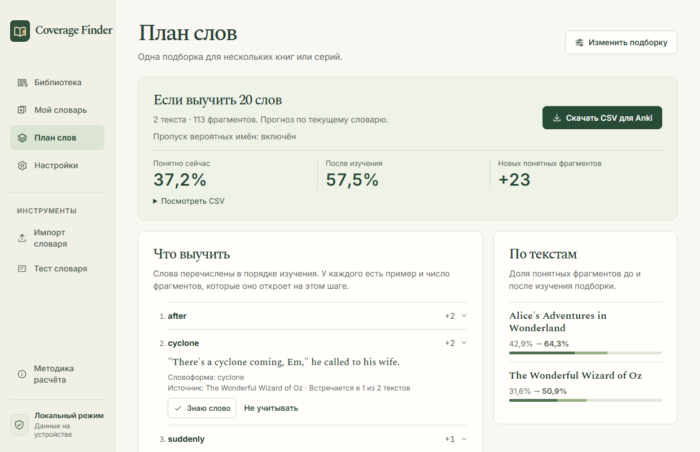

# Coverage Finder: какие 20 слов выучить перед чтением?

[Открыть «Алису» с подсветкой](https://charlz-ferra.github.io/coverage-finder/#text/alice) · [Составить план](https://charlz-ferra.github.io/coverage-finder/#plan) · [Исходный код](../README.md)

Читатель знает большинство слов на странице, но в каждом втором предложении вынужден обращаться к словарю. Обычный частотный список здесь мало помогает: часто встречающееся слово не обязательно откроет хотя бы одну фразу целиком. Coverage Finder отвечает на более конкретный вопрос: какие слова стоит выучить перед этой книгой или серией?

[Посмотреть тот же план на экране телефона](study-plan-mobile.png)

## Одно решение, которое видно читателю

Приложение считает не только знакомые словоупотребления, но и целые предложения без незнакомых лемм. В субтитрах за одну единицу считается блок с таймкодом. Подбор начинается со слова, которое откроет больше всего фрагментов сейчас, а после каждого шага счёт пересчитывается. У карточки остаются исходная фраза и название книги или серии.

В демо из двух книг читателю знакомы 3 000 лемм. Из 113 предложений он может прочитать по словарю **42**. При бюджете в 20 карточек получаются два результата:

| Что хочет учить читатель | Что меняется | Прогноз |
| --- | --- | ---: |
| Всё, что откроет больше предложений | Dorothy, Dinah и Toto занимают три места | 70 из 113 (+28) |
| Лексику, пропуская вероятные имена | В подборку входят `dreamy`, `gaunt`, `generally`, `glance` | 65 из 113 (+23) |

Четыре замены вместо трёх — не опечатка: без `Toto` слово `dearly` уже не открывает своё предложение. Более низкая цифра во втором режиме честнее: пропустить имя не значит выучить его. Это проверяемый прогноз по лексике, а не измерение того, как человек понимает сюжет. [Все 20 шагов](demo-study-plan.md) · [Регрессионный тест](../packages/core/tests/demo-study-plan.test.ts)

## Как это устроено

- **Svelte и TypeScript.** Чтение, подсветка, отметка слова и экспорт карточек работают и на телефоне. Для первой пробы не нужны свои файлы или аккаунт.
- **Web Worker.** Разбор EPUB, TXT и SRT и подбор лемм выполняются за пределами потока интерфейса. Сервер получает запросы только на файлы приложения, а не содержимое личной библиотеки.
- **IndexedDB.** Словарь, планы и страницы чтения переживают перезагрузку. JSON переносит библиотеку на другое устройство; CSV для Anki переносит только показанные карточки.

[Методика и ограничения](methodology.md) · [Архитектурные решения](adr) · [Сценарии проверки в браузере](../tests/e2e/study-plan.spec.ts)
